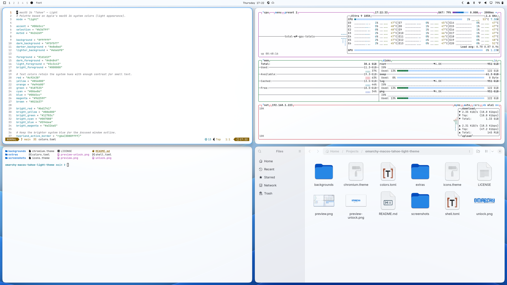
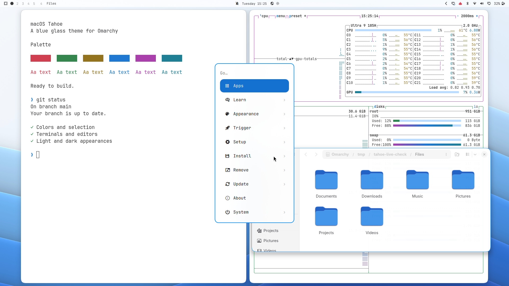
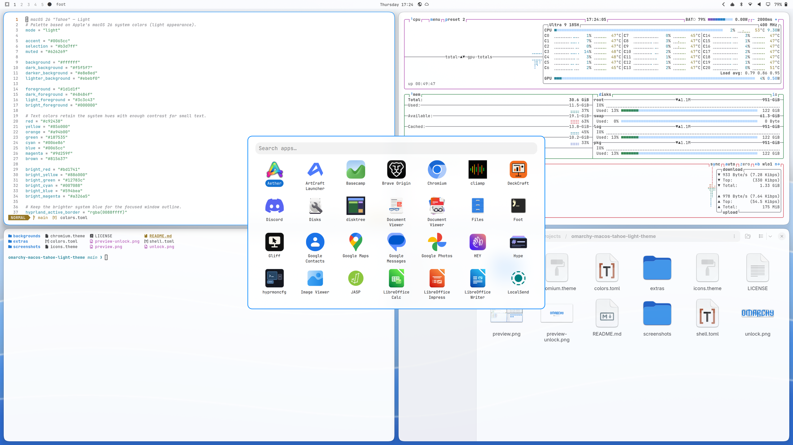
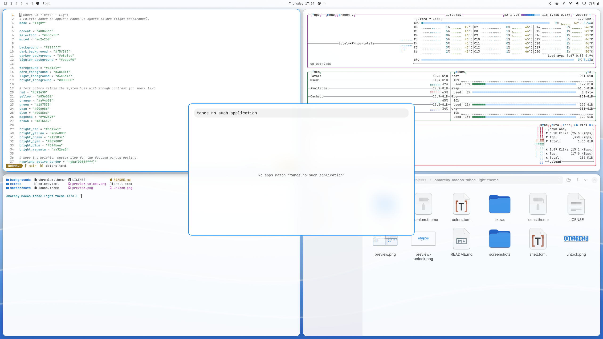
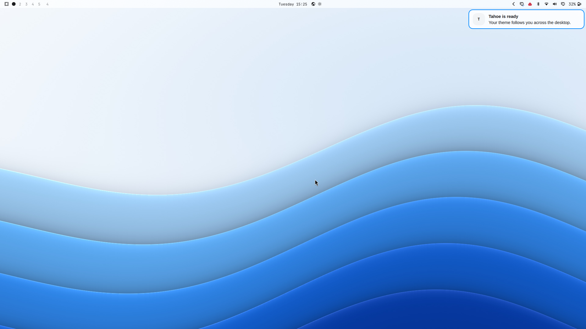
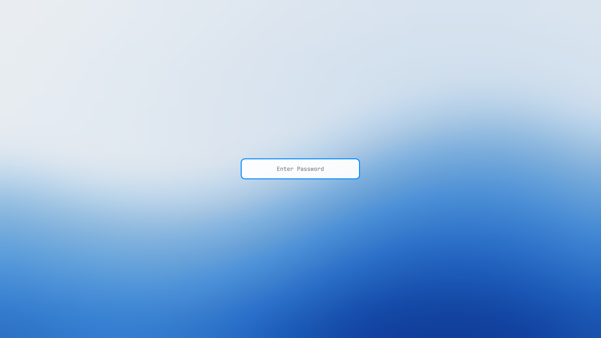
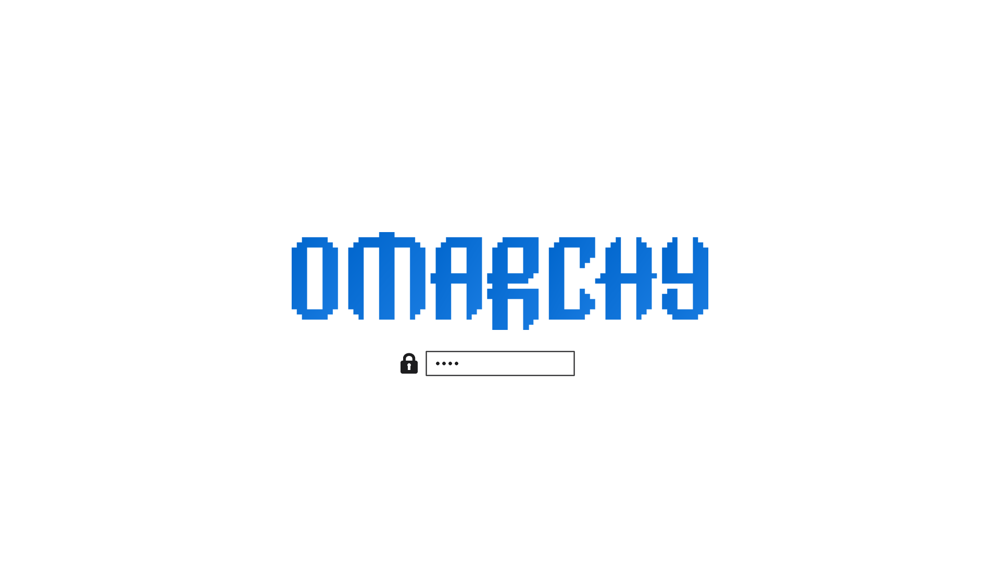

# macOS Tahoe Light for Omarchy

A blue glass theme for [Omarchy](https://omarchy.org), inspired by macOS Tahoe. Pair it with [Tahoe Dark](https://github.com/Assem130/omarchy-macos-tahoe-dark-theme).



## Install

```bash
omarchy theme install https://github.com/Assem130/omarchy-macos-tahoe-light-theme
```

The theme includes colors, translucent shell panels, focused-window borders, Yaru-blue icons, and a neutral Chromium browser color. Omarchy generates the terminal and editor configs from `colors.toml`.

Text colors retain the system hues with enough contrast for small terminal and editor text. The named text colors meet 4.5:1 against the base and raised surfaces. Selected menu and launcher rows use darker blue behind white text. Keyboard focus has a distinct two-pixel border.

## Window style

The theme uses Omarchy's normal window style. For rounded corners, shadows, frosted blur and spring motion, install the optional window style from [macOS Tahoe Extras](https://github.com/Assem130/omarchy-macos-tahoe-extras). That repository also holds the scripts that render the wallpapers and the unlock logo, and the theme checks.

## Animated wallpapers

The new Liquid Tahoe artwork has two playback options:

- `0-liquid-tahoe-light.jpg` has a matching six-second intro in `backgrounds/intros/`. The waves rise into place, then settle into the still image. Omarchy plays the intro when selecting that background or logging in with it selected.
- `5-liquid-tahoe-light-loop.mp4` is a silent twelve-second loop. The wave layers drift and their highlights move continuously.

Both videos are 2560 × 1440, 30 fps, H.264, with no audio. The default still is 3840 × 2160. The original four still wallpapers remain available.

To select the continuous wallpaper after applying this theme:

```bash
omarchy theme bg set ~/.config/omarchy/themes/macos-tahoe-light/backgrounds/5-liquid-tahoe-light-loop.mp4
```

To use the intro and still instead:

```bash
omarchy theme bg set ~/.config/omarchy/themes/macos-tahoe-light/backgrounds/0-liquid-tahoe-light.jpg
```

Omarchy controls video playback, pausing and background selection. Its animation setting suppresses intros. Choose a still image to avoid continuous motion. Video playback uses more power than a still image.

## Desktop previews

The 2560 × 1440 main preview shows an editor, btop, a terminal and Files in a tiled layout. These additional captures show the shell surfaces:

<details>
<summary>Menu, launcher, notification and lock prompt</summary>







</details>

## Lock and unlock

The lock prompt follows the palette and uses the current wallpaper. Its card keeps enough opacity for readable text over light and dark backgrounds.

The separate boot/unlock design uses a blue version of the Omarchy wordmark. It appears under **Style > Unlock**. Selecting it is separate from changing the desktop theme.



## Compatibility

Requires Omarchy 4/Quattro with the native Omarchy shell and Lua-based Hyprland configuration. Tested on Omarchy `4.5.0` with Hyprland `0.56.2`. Omarchy 3's Waybar, Walker and Hyprlock configurations are not included.

Apple's fonts and icons are not included. The theme uses the system font and installed Yaru icons. Not affiliated with or endorsed by Apple.

## License and credits

MIT for the theme and original wave artwork. The unlock graphic adapts [Omarchy's wordmark](https://github.com/omacom/omarchy/blob/quattro/logo.svg), copyright David Heinemeier Hansson. Its permission notice is in [`extras/OMARCHY-LICENSE`](extras/OMARCHY-LICENSE).
